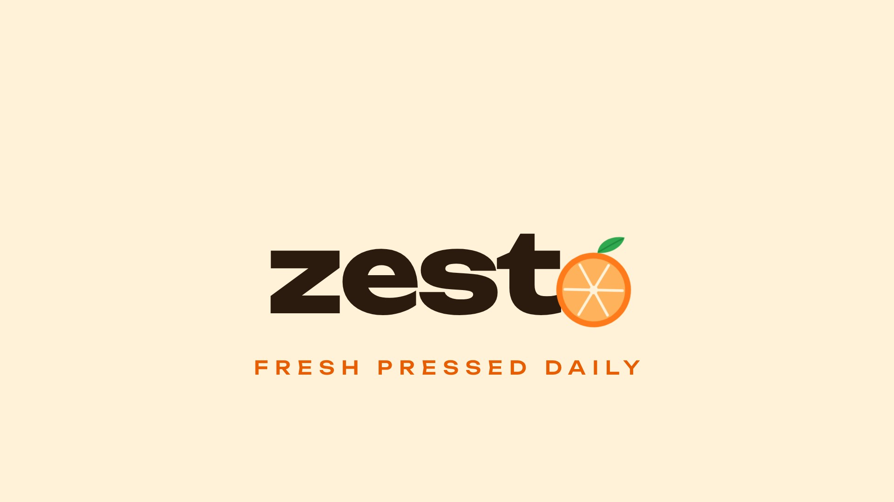

# Zesta — Juice Bar Logo Animation

1920×1080 · ~6 s · 30 fps · H.264



**Render:** [`06_Renders/zesta-logo-animation.mp4`](06_Renders/zesta-logo-animation.mp4)

A juice drop falls, squashes and bounces, splashes, spins into an orange slice, sprouts a leaf and lands in the wordmark as the letter "a".

**Palette & type:** #FFF2D9 cream · #FF7A1A orange · #2FA84F leaf · #2B1B0E ink · Unbounded

## Motion principles

Squash & stretch, overshoot (back-out easing), staggered timing, trim-path line draws and a slow camera push on the hold — the classic logo-animation toolkit from After Effects shape-layer workflows.

## Files

```
02_Scripts/preview.html   the animation (GSAP timeline, opens in any browser and loops)
06_Renders/               MP4 render, poster frame, 4:3 Upwork cover
```

*Fictional brand, created for the portfolio.*
