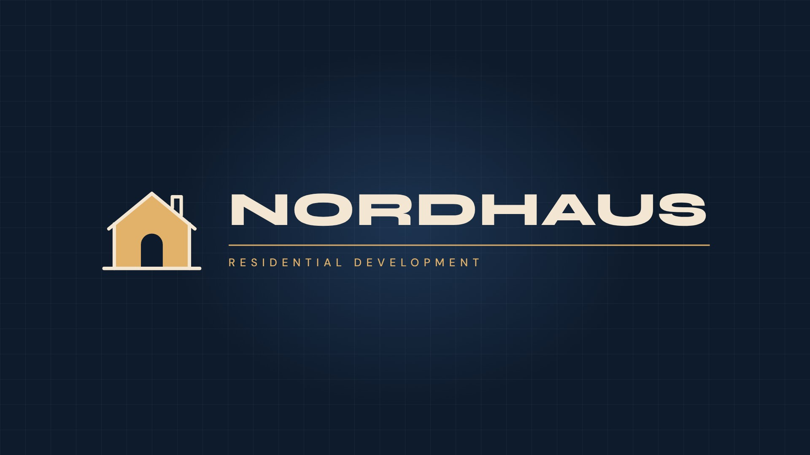

# Nordhaus — Real Estate Logo Animation

1920×1080 · ~6 s · 30 fps · H.264



**Render:** [`06_Renders/nordhaus-logo-animation.mp4`](06_Renders/nordhaus-logo-animation.mp4)

Trim-path line draw builds a house (ground line, walls, roof, chimney), a gold fill wipes up, the door pops, then the mark slides into a lockup with the wordmark and tagline.

**Palette & type:** #0E1B2C navy · #E3B26A gold · #F3E7D3 sand · Syne + DM Sans

## Motion principles

Squash & stretch, overshoot (back-out easing), staggered timing, trim-path line draws and a slow camera push on the hold — the classic logo-animation toolkit from After Effects shape-layer workflows.

## Files

```
02_Scripts/preview.html   the animation (GSAP timeline, opens in any browser and loops)
06_Renders/               MP4 render, poster frame, 4:3 Upwork cover
```

*Fictional brand, created for the portfolio.*
