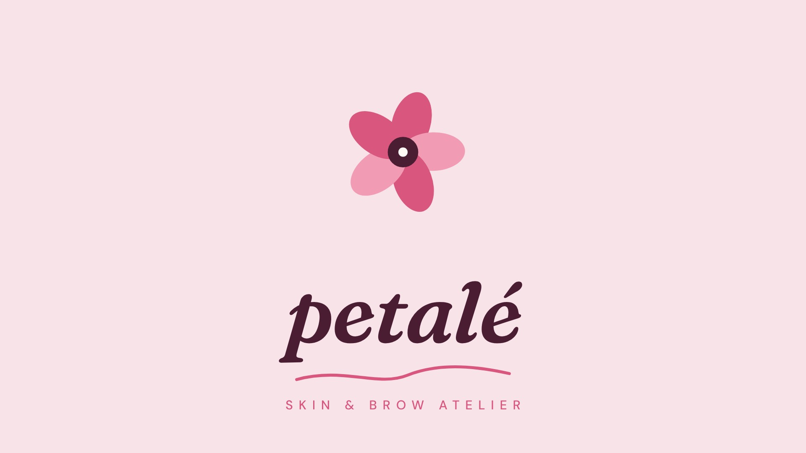

# Petalé — Beauty Logo Animation

1920×1080 · ~6 s · 30 fps · H.264



**Render:** [`06_Renders/petale-logo-animation.mp4`](06_Renders/petale-logo-animation.mp4)

A drop hits the surface, a ring ripples out and five petals bloom one by one with overshoot; the flower rises, the serif wordmark writes in and a swash underline draws.

**Palette & type:** #F8E3E8 blush · #D9577E rose · #4A1D33 plum · Fraunces Italic + DM Sans

## Motion principles

Squash & stretch, overshoot (back-out easing), staggered timing, trim-path line draws and a slow camera push on the hold — the classic logo-animation toolkit from After Effects shape-layer workflows.

## Files

```
02_Scripts/preview.html   the animation (GSAP timeline, opens in any browser and loops)
06_Renders/               MP4 render, poster frame, 4:3 Upwork cover
```

*Fictional brand, created for the portfolio.*
