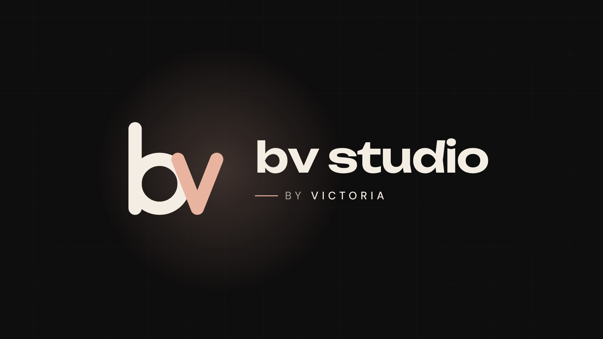

# BV Studio — Logo Animation

1920×1080 · 6.5 s · 30 fps · H.264



**Render:** [`06_Renders/bv-studio-logo-animation.mp4`](06_Renders/bv-studio-logo-animation.mp4)

Logo animation for my own studio brand. A peach dot drops in and becomes the stem of the "b", the bowl draws around, then the "v" draws in with squash & stretch. The mark settles to the left and the wordmark "bv studio — by Victoria" rises in letter by letter.

**Palette & type:** #0F0E0E ink · #F4EDE4 cream · #E8B4A0 peach · Unbounded + DM Sans

## Motion principles

Trim-path line draws, anticipation and squash & stretch, overshoot (back-out easing), staggered type reveal and a slow camera push on the hold.

## Files

```
02_Scripts/preview.html   the animation (GSAP timeline, opens in any browser and loops)
06_Renders/               MP4 render, poster frame, 4:3 Upwork cover (brand board)
```

Brand assets (SVG mark, icon, brand board): [`brand/bv-studio`](../../brand/bv-studio/)
