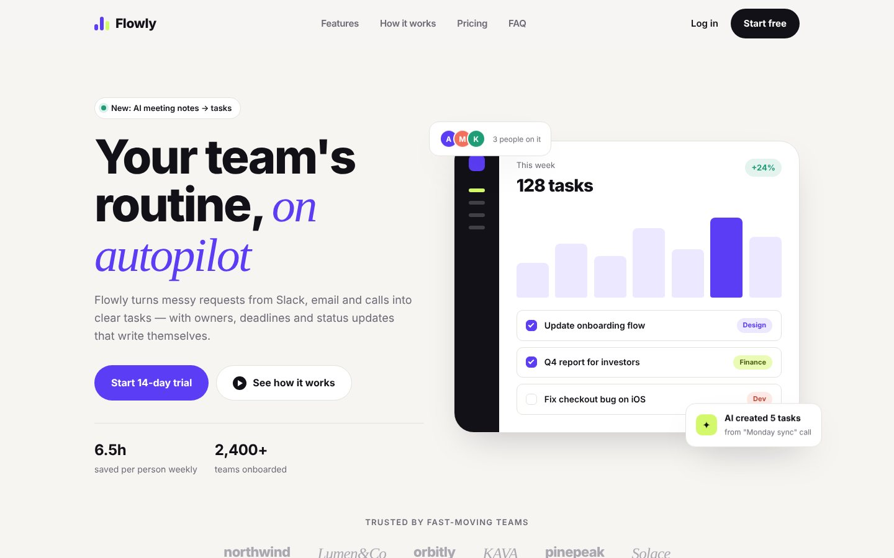

# Flowly — SaaS Landing Page

Landing page for a fictional AI workspace startup.



## Features

- Sticky header + full-screen mobile menu
- Hero with a dashboard mockup built in pure HTML/CSS (no images)
- Bento-grid features
- Tabs "How it works"
- Monthly / yearly pricing toggle
- FAQ accordion (one open at a time)
- Email form with validation
- Reveal-on-scroll animations, `prefers-reduced-motion` support

## Stack

HTML5 (semantic) · SCSS (BEM, mobile-first mixins) · Vanilla JS · Google Fonts · no frameworks, no build step needed to view

## Run locally

Just open `index.html` in a browser. To edit styles:

```bash
npm install
npm run watch   # compiles src/scss → css/style.css on save
npm run build   # minified production CSS
```

## Structure

```
index.html
src/scss/        source styles (partials)
css/style.css    compiled CSS (committed so GitHub Pages works)
js/main.js       interactions
img/             SVG graphics, favicon
preview/         screenshots for the portfolio
```

## Upwork portfolio text

- **Title:** Flowly — AI SaaS Landing Page
- **Description:** Concept landing page for an AI task-management startup. I designed the page and coded it from scratch: responsive HTML, SCSS and vanilla JS with a pricing toggle, tabs, accordion and form validation. The product dashboard in the hero is built in pure CSS, so it stays crisp on any screen and loads instantly.
- **Skills:** Landing Page · Web Design · HTML · CSS · SCSS · JavaScript · Responsive Design · SaaS
- **Images:** `preview/cover-desktop.jpg` (cover), `preview/full-desktop.jpg`, `preview/mobile.jpg`

*Fictional brand, concept project.*
