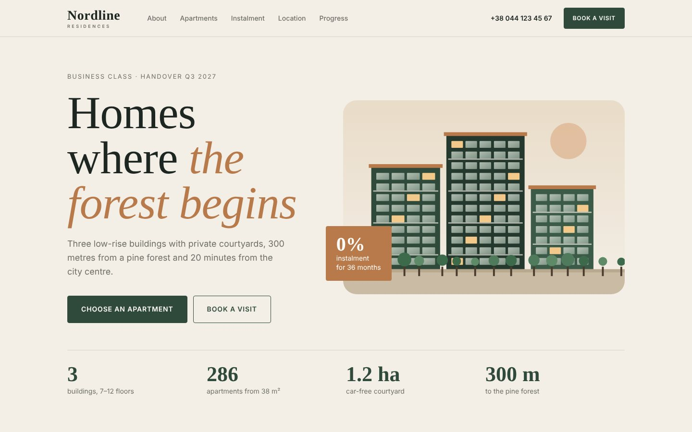

# Nordline Residences — Real Estate Landing

Landing page for a fictional residential complex near a pine forest.



## Features

- Generated SVG illustration of the buildings
- Apartment catalogue rendered from JS data with room filter and SVG floor plans
- 0% instalment calculator with range sliders
- Phone mask +38 (0XX) XXX-XX-XX and form validation
- Accessible modal (Esc, focus return, overlay click)
- Construction-progress bars animated on scroll

## Stack

HTML5 (semantic) · SCSS (BEM, mobile-first mixins) · Vanilla JS · Google Fonts · no frameworks, no build step needed to view

## Run locally

Just open `index.html` in a browser. To edit styles:

```bash
npm install
npm run watch   # compiles src/scss → css/style.css on save
npm run build   # minified production CSS
```

## Structure

```
index.html
src/scss/        source styles (partials)
css/style.css    compiled CSS (committed so GitHub Pages works)
js/main.js       interactions
img/             SVG graphics, favicon
preview/         screenshots for the portfolio
```

## Upwork portfolio text

- **Title:** Nordline Residences — Real Estate Landing Page
- **Description:** Lead-generation landing page for a residential complex: apartment catalogue with room filter and floor plans, instalment calculator, booking modal and a phone form with input mask. Designed and coded in HTML, SCSS and vanilla JavaScript.
- **Skills:** Real Estate Website · Landing Page · Web Design · HTML · SCSS · JavaScript · Lead Generation
- **Images:** `preview/cover-desktop.jpg` (cover), `preview/full-desktop.jpg`, `preview/mobile.jpg`

*Fictional brand, concept project.*
