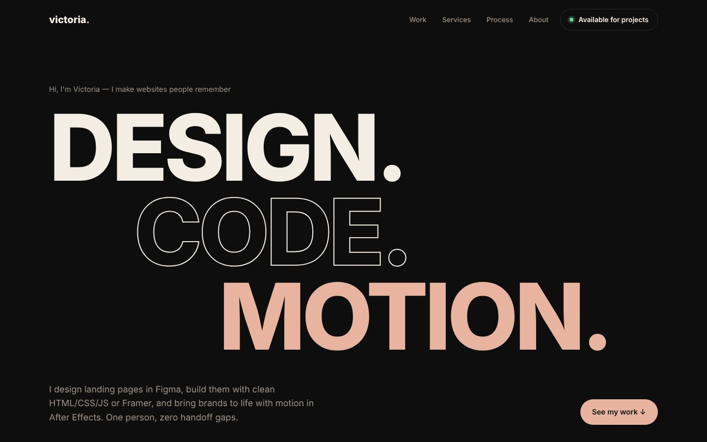

# Victoria — Personal Portfolio Site

My own portfolio website: design, code and motion in one place.



## Features

- Kinetic hero typography and an infinite skills marquee
- Project grid with Web / Motion filter
- CSS-animated motion thumbnails (swap for GIF/MP4 renders)
- Services, process, about, contact sections
- Dark theme, fully responsive

## Stack

HTML5 (semantic) · SCSS (BEM, mobile-first mixins) · Vanilla JS · Google Fonts · no frameworks, no build step needed to view

## Run locally

Just open `index.html` in a browser. To edit styles:

```bash
npm install
npm run watch   # compiles src/scss → css/style.css on save
npm run build   # minified production CSS
```

## Structure

```
index.html
src/scss/        source styles (partials)
css/style.css    compiled CSS (committed so GitHub Pages works)
js/main.js       interactions
img/             SVG graphics, favicon
preview/         screenshots for the portfolio
```

## Upwork portfolio text

- **Title:** Personal Portfolio Website
- **Description:** My portfolio site, designed and coded by me: bold kinetic typography, filterable project grid, services and process sections. HTML, SCSS, vanilla JS.
- **Skills:** Portfolio Website · Web Design · HTML · SCSS · JavaScript
- **Images:** `preview/cover-desktop.jpg` (cover), `preview/full-desktop.jpg`, `preview/mobile.jpg`

*Fictional brand, concept project.*
