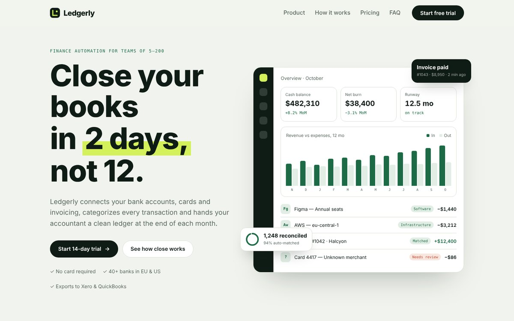

# Ledgerly — Fintech SaaS Landing

Finance automation SaaS for growing teams. Concept project for the portfolio.

## Features

- Animated product dashboard in the hero (bars, counters, floating cards)
- Bento feature grid with cursor spotlight
- Sticky month-end process with scroll progress
- Pricing with monthly / annual switch, FAQ accordion
- Smooth scroll (Lenis) and scroll animations (GSAP + ScrollTrigger)
- Fully responsive, respects `prefers-reduced-motion`

## Stack

HTML5 · CSS (custom properties) · Vanilla JS · GSAP 3 · Lenis · Google Fonts. Single file, no build step: open `index.html`.

*Brand is fictional; created for the portfolio.*
