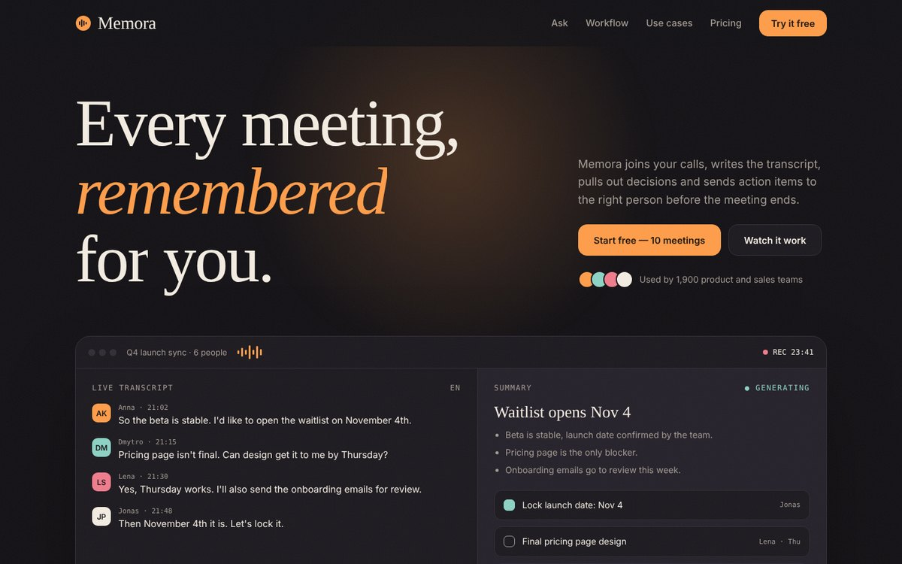

# Memora — AI Meeting Notes Landing

AI tool that records meetings, writes summaries and sends action items. Concept project for the portfolio.

## Features

- Live transcript typing loop with summary and tasks filling in
- Search demo that types the question on scroll
- Stacking scroll cards and a pinned horizontal use-case rail
- Warm dark theme with editorial serif typography
- Smooth scroll (Lenis) and scroll animations (GSAP + ScrollTrigger)
- Fully responsive, respects `prefers-reduced-motion`

## Stack

HTML5 · CSS (custom properties) · Vanilla JS · GSAP 3 · Lenis · Google Fonts. Single file, no build step: open `index.html`.

*Brand is fictional; created for the portfolio.*
