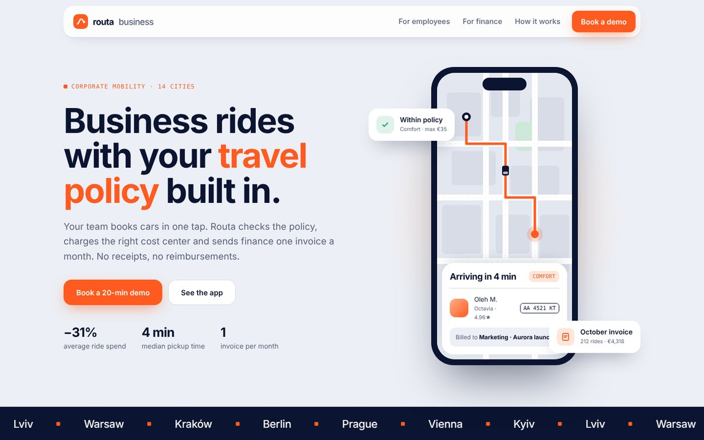

# Routa Business — Corporate Rides App Landing

B2B mobility app with company travel policy built in. Concept project for the portfolio.

## Features

- Phone mockup: route draws on the map, car follows it (GSAP MotionPath)
- Scroll-driven phone that swaps app screens per step
- Finance dashboard with spend by department
- Phone tilt on hover, city ticker, app-download CTA
- Smooth scroll (Lenis) and scroll animations (GSAP + ScrollTrigger)
- Fully responsive, respects `prefers-reduced-motion`

## Stack

HTML5 · CSS (custom properties) · Vanilla JS · GSAP 3 · Lenis · Google Fonts. Single file, no build step: open `index.html`.

*Brand is fictional; created for the portfolio.*
