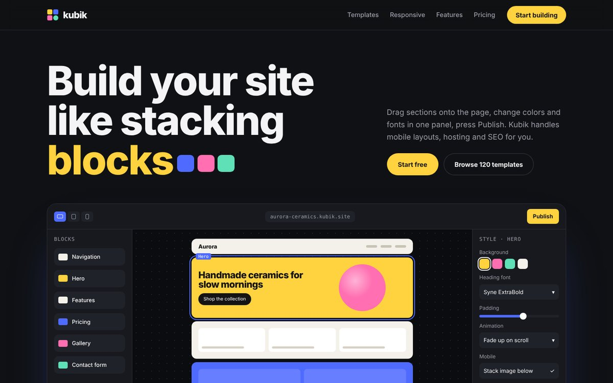

# Kubik — No-Code Website Builder Landing

No-code website builder made of blocks. Concept project for the portfolio.

## Features

- Editor mockup where an animated cursor drags a block, restyles it and publishes
- Two-row template marquee
- Working responsive preview: Desktop / Tablet / Phone
- 3D tilt feature cards, scroll parallax shapes
- Smooth scroll (Lenis) and scroll animations (GSAP + ScrollTrigger)
- Fully responsive, respects `prefers-reduced-motion`

## Stack

HTML5 · CSS (custom properties) · Vanilla JS · GSAP 3 · Lenis · Google Fonts. Single file, no build step: open `index.html`.

*Brand is fictional; created for the portfolio.*
