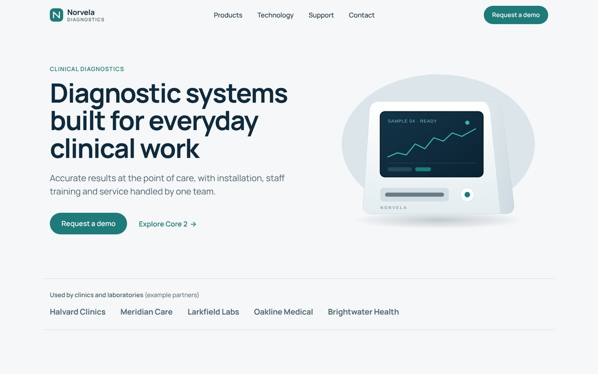
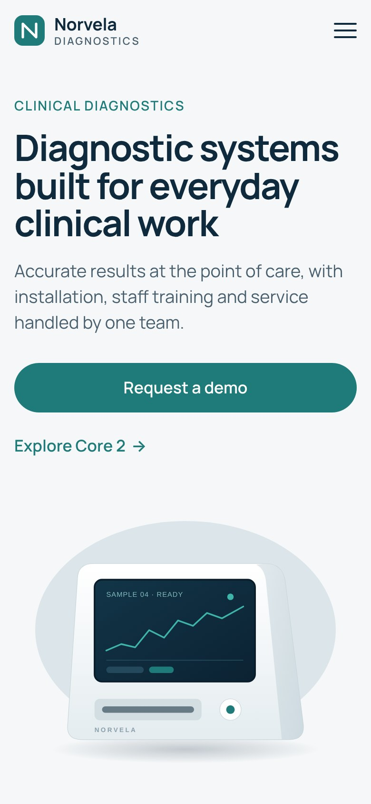

# Norvela Diagnostics — static medical equipment site

Two-page marketing site for a medical equipment company, hand-coded as static HTML, SCSS and vanilla JavaScript on the FLS Gulp + Webpack build. No CMS, no database, nothing on the server to patch. Concept project for the portfolio.

**Live:** [home](https://viktoriabugina.github.io/portfolio/web/08-norvela-diagnostics/) · [product page](https://viktoriabugina.github.io/portfolio/web/08-norvela-diagnostics/product.html)



## Features

- **Static and secure by design:** plain files that deploy to any static host (built for Cloudflare Pages)
- **Protected contact form:** Cloudflare Turnstile, token verified server-side in a Cloudflare Pages Function (`source/functions/api/contact.js`), honeypot field, then sent to a CRM webhook and/or Web3Forms
- **Responsive 320–1440 px:** fluid type and spacing with `clamp()` via the `adaptiveValue` mixin, no horizontal scroll at any width
- **Accessible:** one `h1` per page, skip link, visible focus, keyboard-friendly mobile menu (Esc, focus trap, `aria-expanded`), labelled fields with inline errors, WCAG AA contrast for every color pair
- **Works without JavaScript:** navigation, footer and FAQ (`<details>`) stay usable; motion is off for `prefers-reduced-motion`
- Product page: Swiper gallery with thumbnails, specs table, FAQ, quote form, downloadable PDF brochure

## Stack

HTML5 · SCSS (BEM) · Vanilla JS · FLS start template (Gulp + Webpack) · Swiper 8 · Cloudflare Pages Functions · Turnstile

## Source and build

The folder root is the production build (what GitHub Pages serves). Source code is in [`source/`](source/):

```bash
cd source
npm ci --legacy-peer-deps
npm run dev        # dev server with live reload
npm run devbuild   # production build to dist/
```

To deploy on Cloudflare Pages: build command `npm run devbuild`, output `dist`, add `TURNSTILE_SECRET` (plus optional `CRM_WEBHOOK_URL`, `WEB3FORMS_KEY`) and replace the Turnstile test site key in `src/html/_form.htm`. On GitHub Pages the form shows a demo message instead of sending.



*Norvela is a fictional company; product names, specifications, partners and contacts are placeholders. Device images are original SVG illustrations, ready to swap for product photos.*
