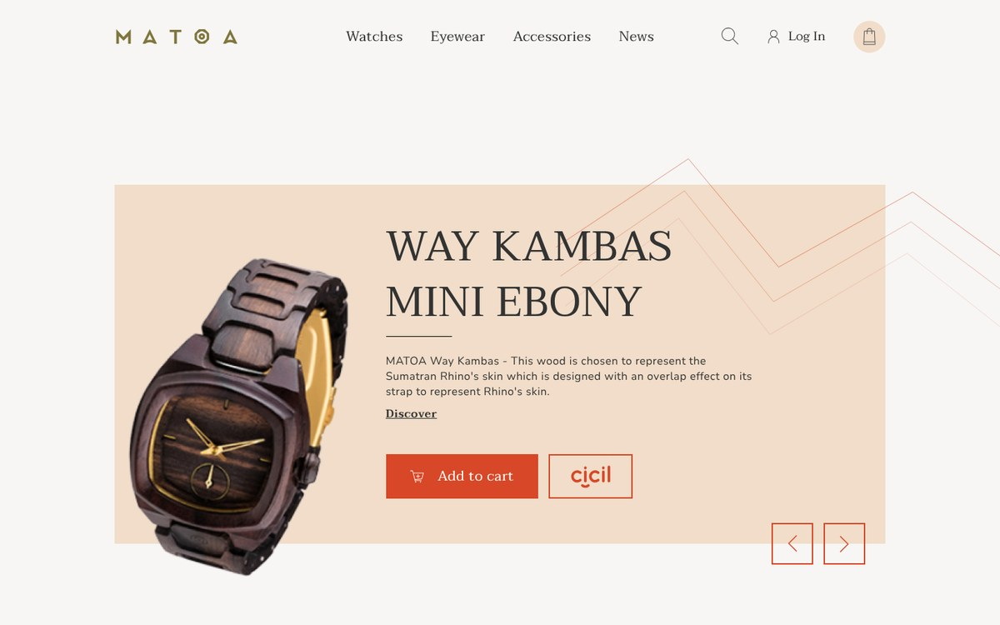
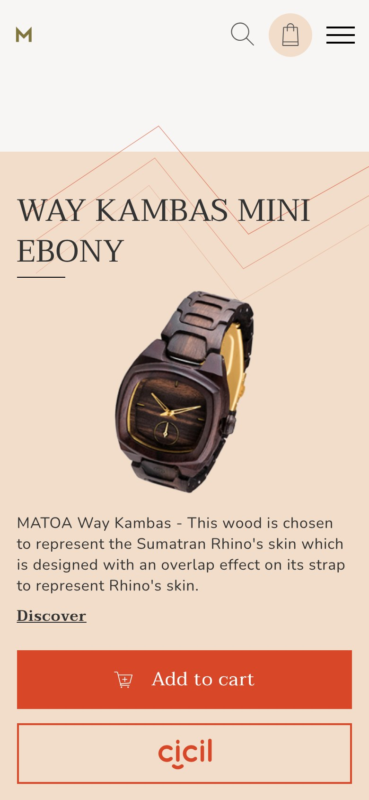

# Matoa — online store layout (training project)

Home page of an online store for wooden watches and eyewear, coded from a Figma mockup on the FLS Gulp + Webpack start template. Made during the "Freelancer for life" HTML/CSS course; reviewed and fixed in 2026.

**Live:** [viktoriabugina.github.io/portfolio/web/09-matoa-store-layout/](https://viktoriabugina.github.io/portfolio/web/09-matoa-store-layout/)



## Features

- Product slider (Swiper) with the image moved into the text column on mobile via dynamic adapt (`data-da`)
- Product cards that reveal actions on hover, with actions always visible on touch devices
- Footer columns that turn into an accordion on tablets and phones (template spoilers)
- Full-screen mobile menu, search popup, scroll-triggered reveal of the category cards
- Fluid sizes with the `adaptiveValue` (`clamp()`) mixin; no horizontal scroll from 320 to 1440 px
- Icon font built from SVG with the template's font task

## 2026 review fixes

- Mobile menu was hidden under the slider: header now has its own stacking context
- Broken footer logo path, misspelled class that dropped the category card titles, invalid `<articale>` tag
- Added an `h1`, fixed heading order, alt texts and `aria-label`s for icon buttons, `aria-expanded` on the burger
- Category cards stay visible without JavaScript and with reduced motion

## Stack

HTML5 · SCSS (BEM) · Vanilla JS · FLS start template (Gulp + Webpack) · Swiper

## Source and build

The folder root is the production build. Source code is in [`source/`](source/):

```bash
cd source
npm ci --legacy-peer-deps
npm run dev     # dev server
npm run build   # production build to dist/
```



*Training layout based on a course mockup. MATOA is a real brand; this page is not affiliated with it and is not a commercial project.*
