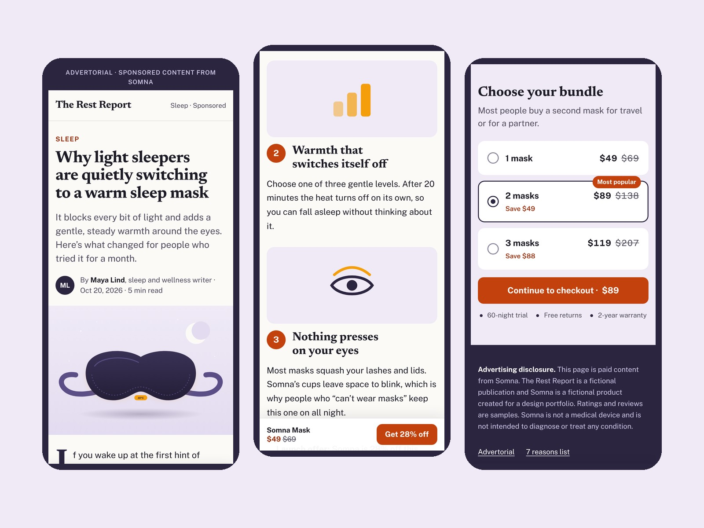
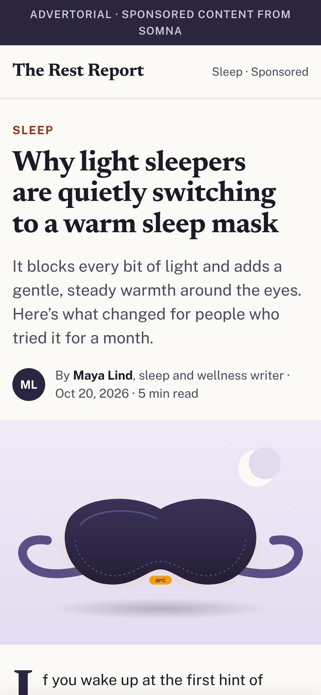

# Somna — DTC advertorial and listicle

Mobile-first pre-sell pages for a fictional DTC product, a warm sleep mask: a long-form **advertorial** and a **"7 reasons" listicle**, both leading to an offer box and a bundle picker. Hand-coded static HTML, SCSS and vanilla JS on the FLS Gulp + Webpack build. Concept project for the portfolio.

**Live:** [advertorial](https://viktoriabugina.github.io/portfolio/web/10-somna-dtc-advertorial/) · [listicle](https://viktoriabugina.github.io/portfolio/web/10-somna-dtc-advertorial/listicle.html)

## What's on the pages

- **Advertorial:** editorial layout (masthead, byline, drop cap, pull quote), product story, "what's inside" diagram, 3-step routine, comparison table, sample reviews, FAQ
- **Listicle:** seven numbered reasons with visuals and a mid-list offer
- **Offer box:** price anchoring, perks, guarantee, single clear CTA
- **Bundle picker:** 1 / 2 / 3 masks with "Most popular" tag; the button total updates live
- **Sticky mobile CTA:** appears after the headline scrolls away and hides when the offer or checkout is on screen, so the call to action is never doubled
- Clear "Advertorial" label at the top and an advertising disclosure in the footer

## Quality

- Built mobile-first for paid social traffic; checked at 320, 375, 480, 768, 1024 and 1440 px with no horizontal scroll
- 18 px body text, 44 px+ tap targets, WCAG AA contrast for every color pair
- Semantic structure: one `h1`, real ordered list for the reasons, accessible table and radio group, FAQ on `
`
- Works without JavaScript; motion off for `prefers-reduced-motion`

## Stack

HTML5 · SCSS (BEM) · Vanilla JS · FLS start template (Gulp + Webpack) · Google Fonts (Newsreader, Public Sans)

Source code is in [`source/`](source/): `npm ci --legacy-peer-deps`, then `npm run dev` or `npm run devbuild`. The same layout ports directly to Shopify page builders (Replo, GemPages, PageFly) or a Shopify section.

*Somna and The Rest Report are fictional. Ratings and reviews are samples. Not a medical device.*
