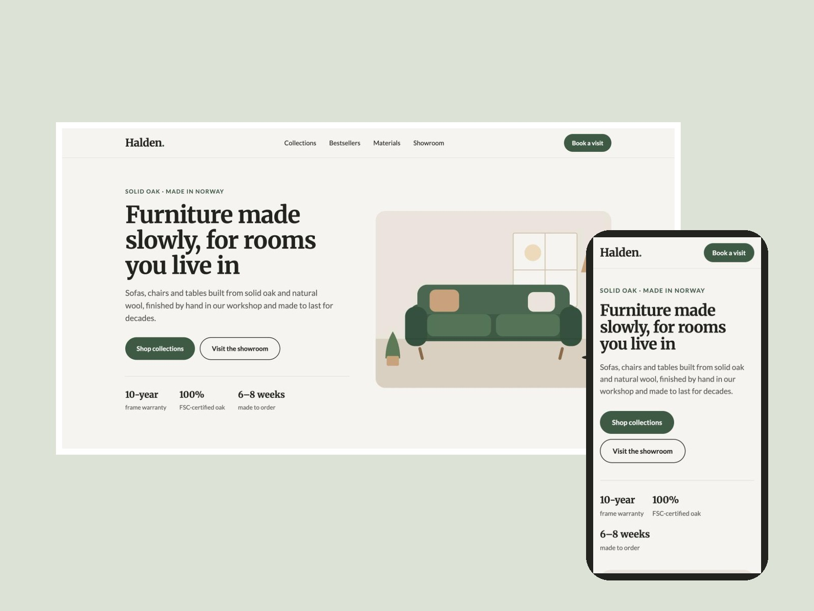
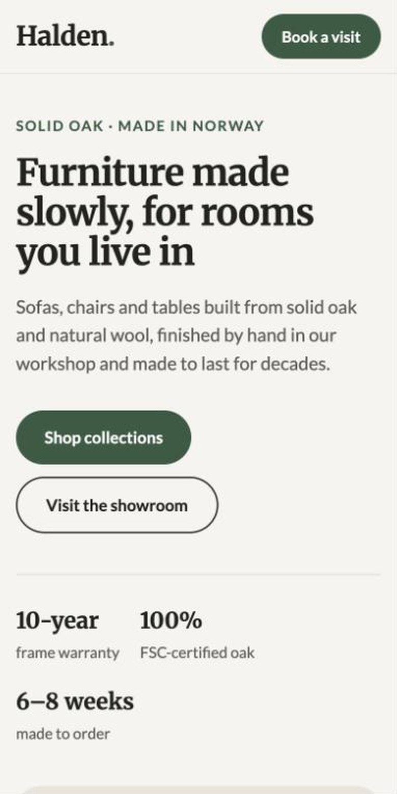

# Halden — furniture landing in Webflow

A one-page landing for a fictional Norwegian furniture brand, built in **Webflow** with Client-First style naming (`padding-global`, `container-large`, `section_*`, `button.is-secondary`). Concept project for the portfolio.

**Live:** [furniture-8d1864.webflow.io](https://furniture-8d1864.webflow.io/)

## Sections

- Sticky navigation with anchor links and a "Book a visit" call to action
- Hero with headline, two actions and three proof points (warranty, FSC oak, lead time)
- Collections grid by room: sofas, chairs, tables, lighting
- Bestsellers with prices
- Materials band on dark moss: oak, wool bouclé, oil finish, explained in plain words
- Showroom block with address, hours and two actions
- Footer with navigation

## Build notes

- Class system in Client-First style: global utility classes plus `section_`, `_component` and `is-` modifiers, so a client's team can keep editing in the Designer without breaking the layout
- Responsive on Webflow's own breakpoints (991 / 767 / 479 px); checked at 390, 768 and 1440 px with no horizontal scroll
- One `h1`, logical heading order, `aria-label` on illustrations, SEO title and description set
- Palette: warm paper `#F5F3EE`, moss `#3F5A45`, ink `#22231F`; type: Merriweather for headings, Lato for text

Illustrations in [`assets/`](assets/) are original SVGs made for this project.

*Halden is fictional. Prices and the showroom address are examples.*
